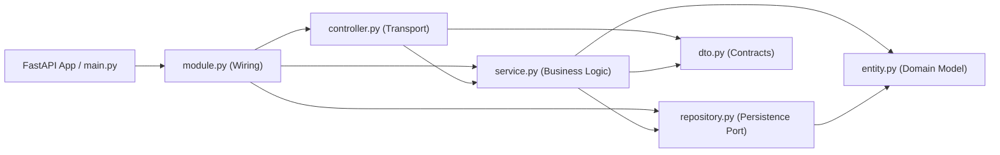

# Architecture Guide

This repository follows a **layered modular monolith** architecture. Every business domain lives in an isolated module with strict, unidirectional dependencies enforced automatically by `tests/test_architecture.py`.

## Dependency Direction



## Module Structure (`src/app/modules/<domain>/`)

Every domain module is organized into six single-purpose files (each capped at 500 lines):

1. **`entity.py`**: Frozen domain dataclasses and invariants. Must never import `dto`, `repository`, `service`, or `controller`.
2. **`dto.py`**: Request/response dataclasses and boundary validation (`validate_add_request`). Must never import `repository`, `service`, or `controller`.
3. **`repository.py`**: Persistence protocol (`MathRepository`) and storage adapters (`InMemoryMathRepository`). Imports only `entity.py`.
4. **`service.py`**: Core business rules and orchestration. Coordinates `dto.py`, `entity.py`, and `repository.py`. Must never import `controller.py`.
5. **`controller.py`**: Transport adapter (FastAPI, CLI, RPC). Accepts raw inputs, invokes `service.py`, and returns `dto.py`. **Forbidden** from importing `repository.py` directly.
6. **`module.py`**: Composition root (`MathModule`) that wires `InMemoryMathRepository` into `MathService` and `MathController`.

## Reference Example: `modules/math`

The included `src/app/modules/math/` module demonstrates this pattern with an addition service exposed via `GET /math/add` that validates operand bounds and records calculation history.

## Adding a New Domain Module

1. Create `src/app/modules/<domain>/` with the six standard files (`__init__.py`, `entity.py`, `dto.py`, `repository.py`, `service.py`, `controller.py`, `module.py`).
2. Wire the module into `src/app/main.py`.
3. Add functional tests in `tests/test_unit.py` and `tests/test_integration.py`, plus boundary assertions in `tests/test_architecture.py`.
4. Run `uv run python -m tools.xtask validate` to verify all eight gates pass.

## Strict AST Policy & Tripwires

- **Policy Lock**: `pyproject.toml` `[tool.policy]` and `tools/lint_check.py` forbid mutable default arguments, bare `except:`, `assert`/`print` in `src/`, dynamic `eval`/`exec`/`shell=True`, `Any` annotations, and public `bool` parameters while enforcing docstrings and full sync/async annotations.
- **Immutable Guardrails**: `tests/test_architecture.py` fails if `[tool.policy]` is weakened, formatter sections are added, or AST lint rules are removed.

## Monorepo Variant Architecture

When scaling into multiple Python services and shared libraries, adopt the `uv` workspace layout:

```text
.
├── apps/                         # Independently deployable services
│   ├── api/                      # FastAPI or web backend service
│   └── worker/                   # Background job or event consumer
├── packages/                     # Shared libraries with explicit public interfaces
│   ├── core/                     # Shared domain models, rules, and validators
│   └── telemetry/                # Structured logging and OTLP instrumentation
├── pyproject.toml                # Root manifest with [tool.uv.workspace] members
└── uv.lock                       # Single deterministic lockfile
```

- **Workspace Dependencies**: Reference workspace members using path sources in root or package configurations.
- **Validation Parity**: Root `python -m tools.xtask validate` runs checks across all workspace packages without virtual environment drift.
